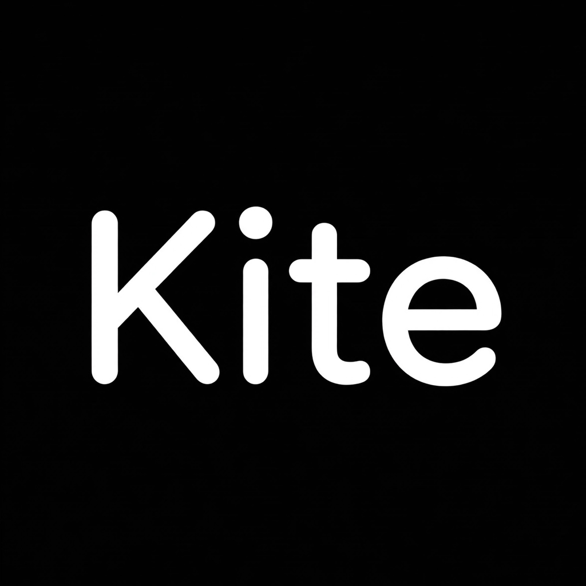
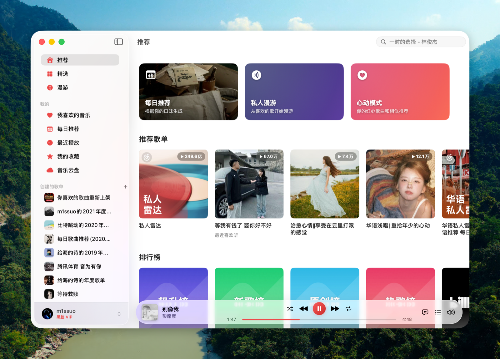
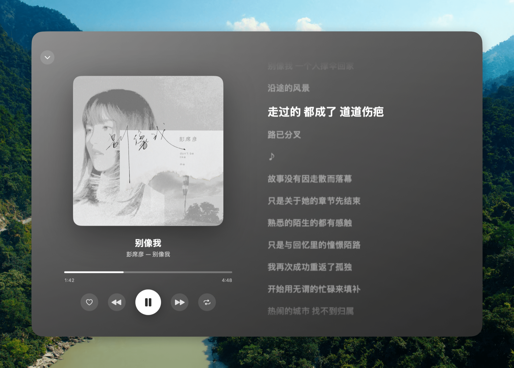
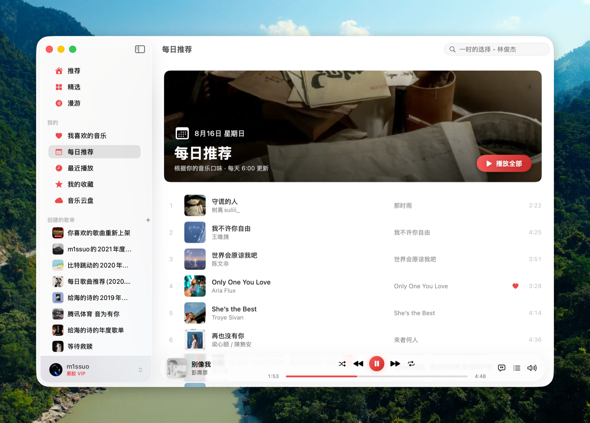
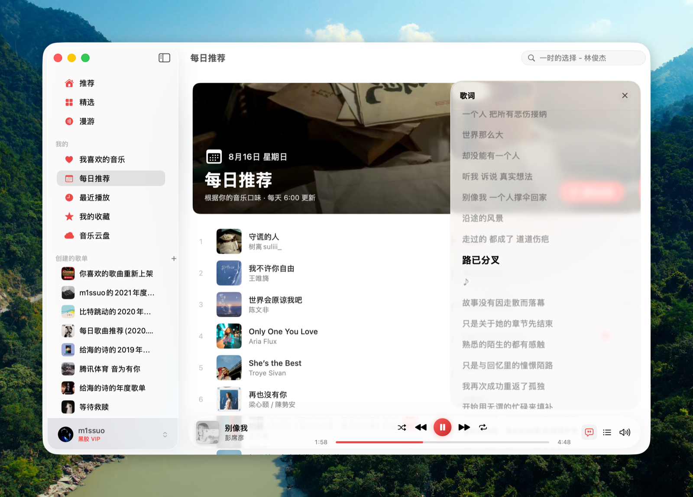

<div align="right">

**English** | [简体中文](README_CN.md)

</div>

<div align="center">



# Kite

**Kite — Native macOS client for NetEase Cloud Music**

Built with SwiftUI · Talks directly to NetEase's real API · Sparkle auto-updates

[](#building)
[](Package.swift)
[](LICENSE)

<table>
  <tr>
    <td></td>
    <td></td>
  </tr>
  <tr>
    <td></td>
    <td></td>
  </tr>
</table>

</div>

## About the Name

**Kite** is a creature that rides the wind. In ancient times, people flew paper kites in the open fields and watched them rise upon the whirlwind, as if to break free from every fetter — yet held always by a single thread, never lost beyond the sky. Freedom, it turns out, is not a line cut loose, but a heart that remains tethered, and still dares to journey far.

The name Kite comes from this. Music itself is like the wind: without form or substance, yet able to lift the human heart. I hope this software may be such a kite, carrying the sound from the clouds into the sky inside every heart. It is the way of life I long for most: not trapped in one corner, but traveling with the wind, and always remembering where it first took flight.

When the wind rises, the kite flies; when the heart stirs, the music begins.

## Features

- 🔐 **QR code login** — scan with the NetEase Cloud Music app; cookies are persisted locally and auto-refreshed
- 🏠 **Home** — daily recommendations, Personal FM, Heartbeat Mode, recommended playlists, radar playlists (Personal Radar family, personalized per account), charts, new albums, recommended artists
- 🧭 **Explore** — category playlists (curated / official / charts / mood) with infinite scrolling
- 🎵 **Playback** — AVPlayer engine, Standard to Hi-Res quality (lossless with 黑胶 VIP, automatic fallback), shuffle / repeat one / repeat all, play-next queue, gray track detection
- 🚗 **CarPlay (iOS, opt-in)** — Now Playing, tabbed library, queue, and search templates ship in the binary; activation requires an [Apple CarPlay audio entitlement](https://developer.apple.com/contact/carplay/), which is not granted to most accounts. Build defaults to disabled so the source tree stays open-source-friendly; see [Enabling CarPlay](#enabling-carplay-ios) below
- 🔓 **Gray track unblocking** — native implementation of UnblockNeteaseMusic's core sources (pyncmd / Kuwo / Kugou); unavailable or trial-only tracks automatically resolve from third-party sources
- 🖼 **Immersive now-playing page** — artwork-tinted gradient backdrop, large artwork, big synced lyrics (click the player-bar artwork to open, Esc to close)
- 📻 **Personal FM** — immersive roaming page with trash / skip
- 📝 **Lyrics** — glass side panel with line-synced lyrics + translation, click to seek
- 🪟 **Desktop lyrics** — LyricsX-style floating always-on-top lyric line with translation; draggable, persisted position, visible across Spaces and full-screen apps
- 📚 **Library** — liked songs, created / subscribed playlists, saved albums, followed artists, recently played, cloud disk
- ✏️ **Playlist management** — create / delete / subscribe playlists, add / remove tracks, heart songs
- 🔍 **Search** — aggregate / songs / artists / albums / playlists, trending keyword placeholder
- ⌨️ **System integration** — media keys / Control Center (Now Playing), scrobbling, playback queue restored across launches
- ☁️ **iCloud Sync** — hand off playback progress and queues between Mac and iPhone, sync preferences, and share sign-in sessions; works via iCloud Drive shared folders and natively supports sideloaded builds without central servers (see [documentation](docs/icloud-sync/icloud-sync.md))
- 🌐 **Localization** — English and Simplified Chinese, following the system language; bilingual release notes in Sparkle updates

## Installation

Requires macOS 15+ (Universal: Apple Silicon and Intel).

### Homebrew

```bash
brew install owo-network/brew/Kite --cask
```

### Manual download

Download the latest `Kite-x.y.z.zip` from
[Releases](https://github.com/missuo/Kite/releases/latest), unzip, and drag
it into Applications.

The app is signed with a Developer ID certificate and notarized by Apple, with
built-in Sparkle automatic updates (menu bar: Kite → Check for Updates…).

### iOS / iPadOS (sideload)

Every release ships an **unsigned** `Kite-iOS-x.y.z.ipa` (iOS 16+). Kite
is an unofficial client and will not be on the App Store or TestFlight, so
install it with a sideloading tool that signs the IPA with your own Apple ID —
[AltStore](https://altstore.io), [SideStore](https://sidestore.io),
[Sideloadly](https://sideloadly.io) or Xcode all work. On iOS 26+ the tab bar is the system’s native Liquid Glass; on iOS 16–25 it falls back to a simulated glass bar.

Updating: iOS apps can't replace themselves. Settings → About → **Check for
Updates** tells you when a newer release exists and links to it; download the
new IPA and reinstall with the same tool — sign-in state and settings are kept.
AltStore / SideStore can also track the release automatically: add the source
<https://github.com/missuo/Kite/releases/latest/download/altstore.json> and
new versions show up in their update list on their own.

#### In-app auto-update (TrollStore only)

On a device with **[TrollStore](https://github.com/opa334/TrollStore)** (巨魔),
Kite updates itself: Settings → About → **Check for Updates** (it also checks
on launch) downloads the new IPA with a progress ring and hands it to TrollStore
via `apple-magnifier://install?url=…` for a one-tap, fully automatic install —
the same mechanism Dopamine uses. This works **only under TrollStore**: a plain
AltStore/SideStore sideload is signed with a personal certificate and has no way
to install an IPA on-device, so there it degrades to opening the release page
for a manual re-sideload.

### Enabling CarPlay (iOS)

CarPlay support is fully implemented in `Sources/Kite/Core/CarPlay/`, but the
**default build ships none of it**: no `com.apple.developer.carplay-audio`
entitlement, no `UISupportsCarPlay`, and no CarPlay scene declaration. Apple
only grants that entitlement after you submit a CarPlay audio app
[application](https://developer.apple.com/contact/carplay/), and building with
it unapproved fails to sign with:

> Entitlement com.apple.developer.carplay-audio not found and could not be
> included in profile.

So CarPlay is a one-command opt-in instead:

```bash
make configure-carplay   # enable
make configure           # back to the default, CarPlay-free build
```

`make configure-carplay` derives a CarPlay copy of `Config/Info.plist` and
`Config/KiteIOS.entitlements` into `ios/Config/Generated/`, then writes
`ios/Config/CarPlay.local.xcconfig` to point the build at them. All three files
are untracked, and the Xcode project itself is never modified — so enabling
CarPlay leaves `git status` clean and produces nothing to review.

Once your developer account has the entitlement approved:

1. Apply for and obtain the **CarPlay (Audio)** capability for your App ID in
   [Apple Developer → Identifiers](https://developer.apple.com/account/resources/identifiers/list).
2. Regenerate the provisioning profile so it carries the new capability.
3. Run `make configure-carplay`.
4. `Cmd + Shift + K` and rebuild on a device.

To test without a car, use the CarPlay Simulator: Xcode ▸ Open Developer Tool ▸
Simulator, then I/O ▸ External Displays ▸ CarPlay.

## Building

Requires macOS 15+ and Xcode 26+.

```bash
swift build                    # compile
Scripts/build-app.sh           # package the .app (outputs .build/app/Kite.app)
Scripts/compile_and_run.sh     # kill → repackage → relaunch
```

## Architecture

```
Sources/Kite/
├── Core/
│   ├── API/            # NeteaseCrypto (weapi/eapi encryption), NeteaseClient (transport + cookies), NeteaseAPI (~50 endpoints)
│   ├── Models/         # unified Track model (tolerates both JSON shapes), lyrics parser
│   ├── Player/         # PlayerService (queue / shuffle / repeat / FM / URL resolution), UnblockService, NowPlayingManager
│   ├── Storage/        # AccountStore, SettingsManager, two-tier image cache
│   └── Sync/           # SyncService (cross-device playback handoff, preferences & login sync via iCloud Drive)
├── DesignSystem/       # design tokens, button styles (hover scale / row highlight / chips), skeletons, cards, marquee, artwork palette
└── Features/           # pages + player bar + immersive now-playing + lyrics/queue panels
```

No third-party API server involved: weapi (double AES-CBC + RSA) and eapi
(AES-ECB + MD5 digest) encryption are implemented natively in Swift, and
requests go straight to `music.163.com` / `interface.music.163.com`.

## Related projects

Want a **tvOS** build? Check out [Sonimbus](https://github.com/gee1k/sonimbus), a NetEase Cloud Music client for Apple TV maintained by my friend Svend.

## Credits

Kite is written from scratch in Swift. No code was copied from the projects
below, but their design and implementation ideas were referenced extensively:

- [YesPlayMusic](https://github.com/qier222/YesPlayMusic) (MIT, © qier222) — feature design, NetEase API endpoints and behavior
- [kaset](https://github.com/sozercan/kaset) (MIT, © sozercan) — UI design system, motion, and SwiftPM packaging approach
- [UnblockNeteaseMusic/server](https://github.com/UnblockNeteaseMusic/server) (LGPL-3.0-only) — third-party source endpoints and matching strategy for gray tracks (`UnblockService.swift` is an independent Swift reimplementation)
- [LyricsX](https://github.com/ddddxxx/LyricsX) (MPL-2.0, © ddddxxx) — desktop lyrics window design reference (window configuration, screen-factor positioning; `DesktopLyrics.swift` is an independent SwiftUI implementation)

## License

Licensed under [LGPL-3.0-only](LICENSE) (the [GPL-3.0](COPYING) text is
included alongside). For learning and personal use only — all music data and
rights belong to NetEase Cloud Music and the respective source platforms. No
downloading, no social features.

> **Attribution:** This project is a rebranded modification of [Kumone](https://github.com/missuo/kumone) by missuo, licensed under LGPL-3.0. The original LICENSE and COPYING files are preserved unchanged.
