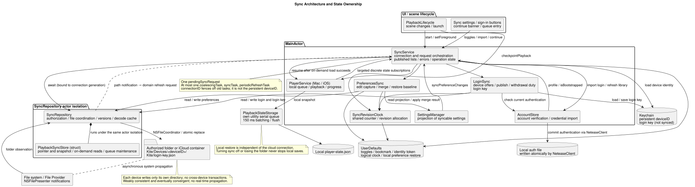
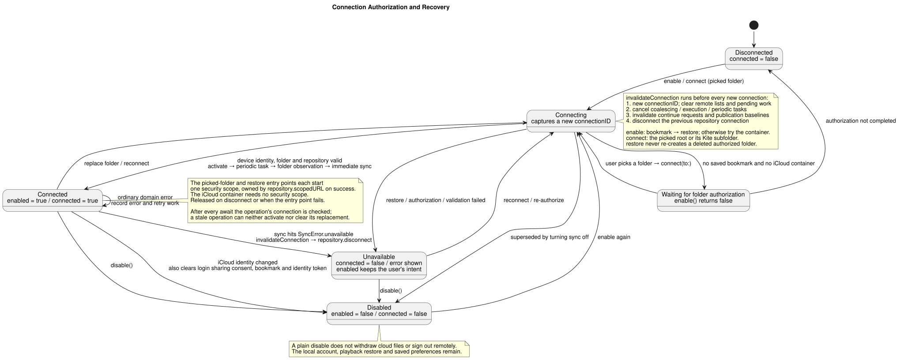
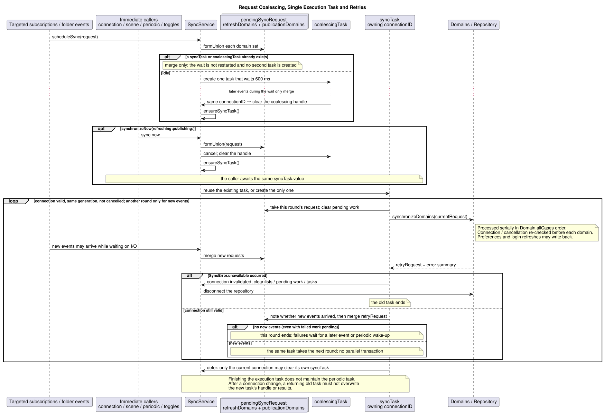
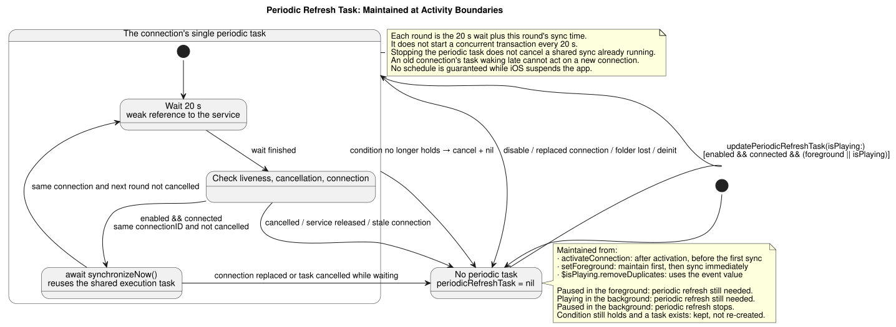
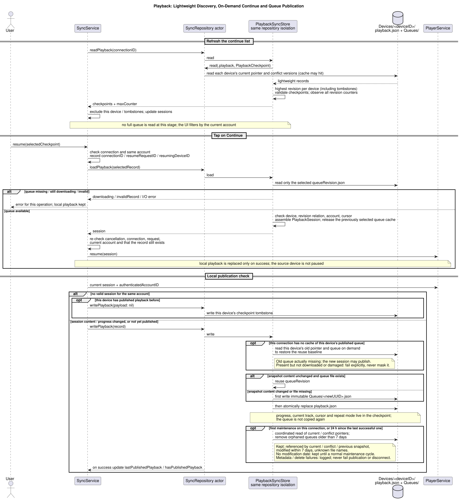
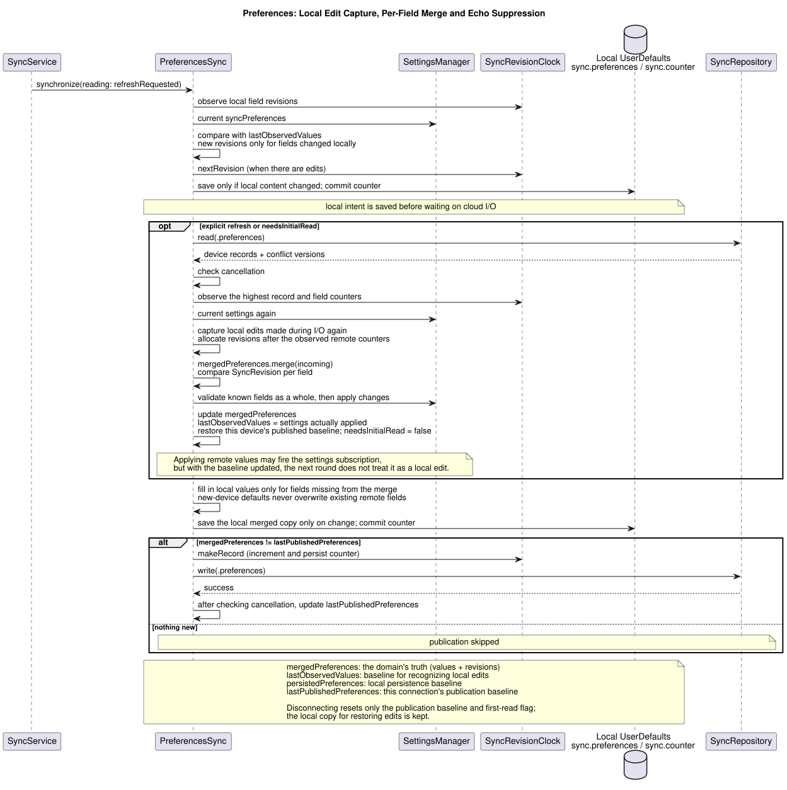
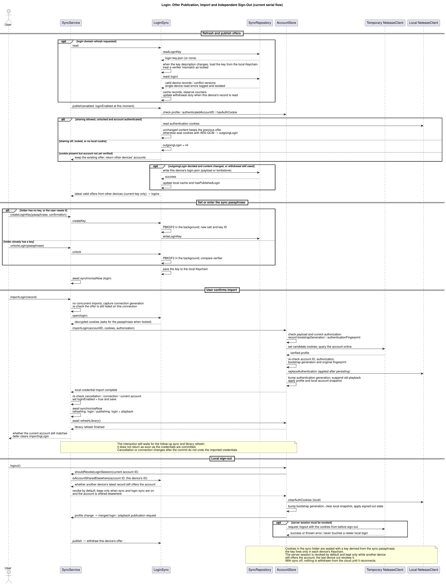
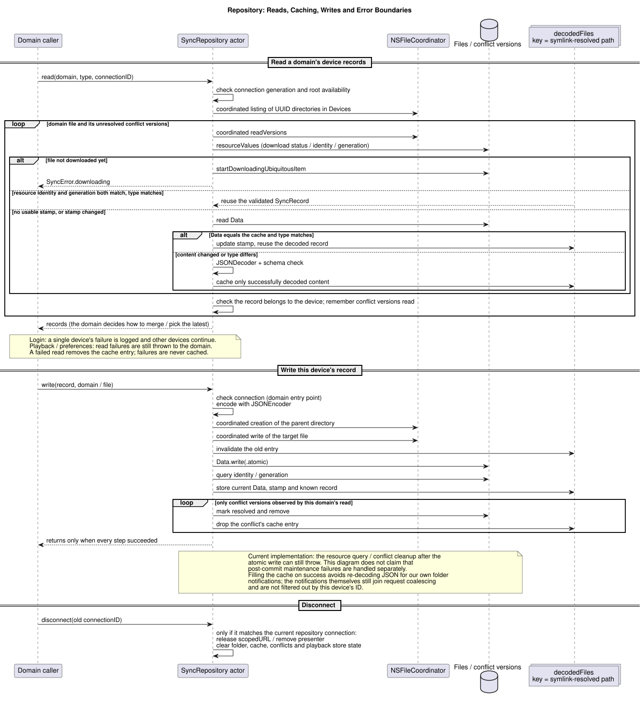

# iCloud Sync Implementation

## Architecture and Responsibilities



*([architecture.puml](architecture.puml))*

| Context | Component | Responsibilities |
|:--------|:----------|:-----------------|
| **UI and lifecycle** | `SyncSettingsSection`<br>`PlaybackHandoff`<br>`SyncedLoginButtons`<br>`PlaybackLifecycle` | Settings toggles, folder authorization, the continue-playback entry point and account import; observes app launch, foreground/background transitions and termination. |
| **Coordination** | [`SyncService`](../../Sources/Kite/Core/Sync/SyncService.swift) | Service facade and main coordinator. Owns the `connectionID` generation, merges pending domain work, runs the single execution loop `syncTask` and the periodic refresh `periodicRefreshTask`, and publishes UI state (`sessions`, `logins`, `loginKeyState`, `errorMessage`). |
| **Logical clock** | [`SyncRevisionClock`](../../Sources/Kite/Core/Sync/SyncRevisionClock.swift) | Maintains the monotonically increasing `counter`, hands out `SyncRevision(counter, deviceID)`, and provides the ordering for per-field LWW in preferences. |
| **Domains** | [`PreferencesSync`](../../Sources/Kite/Core/Sync/PreferencesSync.swift)<br>[`LoginSync`](../../Sources/Kite/Core/Sync/LoginSync.swift) | **Preferences**: per-field LWW merge; captures local edits and suppresses echoes with `lastObservedValues`.<br>**Login**: publishes this device's sealed sign-in offer and withdraws it with a tombstone; collects other devices' offers; holds the folder's login key. |
| **Repository** | [`SyncRepository`](../../Sources/Kite/Core/Sync/SyncRepository.swift)<br>[`PlaybackSyncStore`](../../Sources/Kite/Core/Sync/PlaybackSyncStore.swift) | **Repository actor**: owns the `scopedURL` lifecycle, coordinates reads and writes with `NSFileCoordinator`, caches decoded records by file stamp, and cleans up `NSFileVersion` conflict versions.<br>**Playback store (struct)**: runs inside the repository's isolation; reuses queue snapshots and removes orphaned queues after 7 days. |
| **Local engine** | [`PlaybackStateStorage`](../../Sources/Kite/Core/Sync/PlaybackStateStorage.swift) | Its own serial queue; batches writes of the local `player-state.json` in a 150 ms debounce window and flushes synchronously on termination. |
| **Folder observation** | `SyncDirectoryPresenter` | An `NSFilePresenter` on the sync root that turns path events into refresh requests for the matching domains. |

---

## Identifiers and Envelope

### Identifiers

| Identifier | Stored in | Lifetime | Purpose |
|:-----------|:----------|:---------|:--------|
| `deviceID` | Local Keychain | Permanent (reused after reinstall within the same Keychain access group) | Names this device's write directory; never roams to the cloud. |
| `connectionID` | Memory | New UUID whenever a connection is established, invalidated or re-established | Distinguishes connection generations; async I/O results from an old connection are discarded. |
| `resumeRequestID` | Memory | New on every tap on Continue | Distinguishes continue requests; invalidates an unfinished earlier load. |
| `SyncRevision` | Envelope field | Stored with the record in the cloud file | Logical version; decides which data is newer and whether a deletion wins. |
| `queueRevision` | Queue file name | Reused for as long as the queue is unchanged | Unique id of a queue snapshot, referenced by the checkpoint. |
| `updatedAt` | Envelope field | Wall-clock time of each write | Only for relative times in the UI and expiry checks; never used for ordering. |

### Envelope

Every sync file uses the same envelope:

```swift
struct SyncRecord<Payload: Codable>: Codable, Identifiable {
    let schemaVersion: Int // Format version
    let revision: SyncRevision // Logical revision (global monotonic counter + deviceID)
    let deviceName: String // Device name (shown in the UI)
    let updatedAt: Date // Wall-clock update time (display and expiry only)
    let payload: Payload? // Domain payload; nil is this device's deletion marker (tombstone)
}
```

- **Tombstones**: `payload == nil` means this device deleted the record. A tombstone with a higher revision overrides valid data with a lower one.

---

## Folder Layout and Storage Boundaries

### Shared folder

```text
Kite/
├── repository.json                                     # Repository metadata
├── login-key.json                                      # Login key description (key ID, salt, rounds, verifier; never the key)
└── Devices/
    ├── <Device-UUID-A>/                                # Device A's namespace
    │   ├── playback.json                               # Lightweight checkpoint (current track, progress, cursor, queueRevision)
    │   ├── preferences.json                            # Preferences (with per-field revisions)
    │   ├── login.json                                  # Sign-in offer (account ID, nickname, key ID, sealed cookies; nil = withdrawn)
    │   └── Queues/                                     # Immutable queue snapshots
    │       ├── <Queue-Revision-UUID-1>.json            # Full queue snapshot (deduplicated tracks, shuffle order, ...)
    │       └── <Queue-Revision-UUID-2>.json
    └── <Device-UUID-B>/
        └── ...
```

### Local vs. shared storage

```text
Local Keychain                   Local UserDefaults
├── deviceID                     ├── toggles, security-scoped bookmark, iCloud identity token
└── login key (not synced)       ├── sync.counter (clock counter)
                                 └── sync.preferences (merged fields + observed-value projection)
Local playback restore
└── player-state.json

Sync folder (iCloud Drive / user-authorized folder)
└── Kite/
    └── ...
```

- **Keychain failures**: if the Keychain cannot be read, connecting fails with an error. A random temporary ID is never used, so no orphaned device directories appear in the cloud.
- **Local playback state is independent**: scene changes save a local playback checkpoint, which `PlaybackStateStorage` batches in a 150 ms window and flushes synchronously on normal termination. Saving locally never depends on the cloud being available.

---

## Connection and Folder Authorization



*([connection.puml](connection.puml))*

### States

- **Disconnected**: initial or switched-off state.
- **Connecting**: `enable()` or `connect(to:)` creates a new `connectionID` and invalidates the old connection.
  With a saved bookmark, `enable()` restores it and fails if restoring fails; without one it tries the app's iCloud container, and if that is unavailable the UI asks for a folder.
  `connect(to:)` connects to a folder the user picked. `repository.json` is validated before connecting, and a security-scoped bookmark is saved after a picked folder or a restored bookmark succeeds.
- **Connected**: holds a validated folder connection, registers for folder notifications and runs an immediate first sync; a 20 s periodic refresh runs while the app is in the foreground or still playing.
- **Unavailable**: a `SyncError.unavailable` caught during sync or I/O trips a silent circuit breaker: `scopedURL` is released, the observer removed and remote state cleared; settings are kept and a "Reconnect" button is shown.
- **Disabled**: the user turned sync off; all tasks and resources are released. Cloud files are not deleted and no account is signed out remotely.

### Authorization rules

- **Single owner**: picking a folder (`connect`) and restoring a bookmark (`restore`) each call `startAccessingSecurityScopedResource()` once; when it returns true the repository's `scopedURL` owns the grant until disconnect or failure. The app's iCloud container needs no security scope.
- **No accidental re-creation**: if a restored bookmark points to a folder that no longer exists, `SyncError.unavailable` is returned and the folder is not re-created with `createDirectory`.
- **Silent circuit breaker**: on `SyncError.unavailable` during sync, the connection is dropped, the observer removed and the continue and shared-account lists cleared; the error stays in Settings rather than showing a global alert.
- **Switching off**: `disable()` only stops local sync and timers. It does not delete files in the cloud or sign anyone out remotely.

---

## Request Coalescing and Scheduling



*([scheduling.puml](scheduling.puml))*



*([periodic-refresh.puml](periodic-refresh.puml))*

### Service entry points

| Method | Scheduling and contract |
|:-------|:------------------------|
| `start()` | Registers Combine subscriptions and restores the connection from saved settings and bookmark. |
| `scheduleSync(request)` | Merges domain work into `pendingSyncRequest`; when idle, starts a 600 ms coalescing window (`coalescingTask`). **New events only join the pending work; they do not restart the countdown.** |
| `synchronizeNow(refreshing:publishing:)` | Merges the work, cancels the pending 600 ms wait, and starts or awaits the shared `syncTask`. |
| `ensureSyncTask()` | Reuses the running task, or starts the connection's single async execution loop. |
| `synchronizeDomains(...)` | Syncs domains one after another and collects failed domains into `retryRequest`. |
| `updatePeriodicRefreshTask(isPlaying:)` | Runs the 20 s periodic task only while `enabled && connected && (foreground \|\| isPlaying)`. |

### Trigger matrix

| Event | Refresh | Publish | Scheduling | Notes |
|:------|:--------|:--------|:-----------|:------|
| **Connection established** | All domains | All domains | Immediate, awaited | Initial full alignment. |
| **Foreground / background** | All domains | All domains | Immediate, awaited | Align on entering the foreground; one write check before going to the background. |
| **Periodic wake-up** | All domains | All domains | 20 s timer | Covers file notifications the system may have missed while active. |
| **Playback state change** (track / queue / shuffle / FM) | None | Playback | 600 ms coalescing | Discrete state changes are debounced and batched. |
| **Play / pause** | None | Playback | Update periodic task + 600 ms publish | Pausing in the background stops the periodic task. |
| **Preference edit** | None | Preferences | 600 ms coalescing | The edited field gets a new counter and is committed. |
| **Account profile / authentication change** | None | Login, playback | 600 ms coalescing | Signing out publishes the login tombstone. |
| **Folder change notification** | Affected domains | None explicitly | 600 ms coalescing | Only handled on an active connection; a domain may write back as a result. |
| **Login sync toggled** | Login | Login | Immediate, awaited | Publishes the offer or its tombstone right away. |
| **Sync passphrase set or entered** | Login | Login | Immediate, awaited | Publishes an offer sealed with the new key, or withdraws one that can no longer be opened. |
| **Login import succeeded** | Login | Login, playback | Serial, awaited | After verification, syncs with the folder and refreshes the library. |
| **Tap on Continue** | The full queue the record references | None | Separate on-demand load | Loads only the target snapshot, not every queue, and hands it to the player. |

---

## Domains

### Playback



*([playback.puml](playback.puml))*

- **Pointer and snapshot are separate**:
    - Immutable queue snapshot (`Queues/<UUID>.json`): deduplicated track metadata, the original list and the shuffle order. Reused across sessions while the content is unchanged.
    - Lightweight checkpoint (`playback.json`): account, current track, progress in seconds, current index and the `queueRevision` reference. Routine progress updates only write this file.
- **On-demand continue**: refreshing the list reads only other devices' `playback.json`, never the full queues. The matching `queueRevision.json` is fetched only after the user taps Continue, and handed to the player after the account and cursor are checked.
- **7-day orphan queue cleanup (GC)**: checked on the first write after a connection is activated and every 24 hours after that. Queues referenced by the current pointer or a conflict version, and queues modified within 7 days, are kept; unreferenced queues older than 7 days are deleted. Cleanup failures are logged and never block publishing.
- **Account consistency**: playback is published only while the current NetEase account matches the session's account; otherwise nothing is published and a tombstone withdraws the old data.

---

### Preferences



*([preferences.puml](preferences.puml))*

- **Per-field LWW merge**: each preference field carries the `SyncRevision` of its last edit. Conflicts are resolved per field and the higher revision wins, independent of device clocks.
- **Echo suppression**: `lastObservedValues` records the adopted settings projection. When a remote value is applied locally, the baseline is updated too, so the Combine observers do not mistake the remote write for a new local edit.
- **Local-only settings**: volume, audio output device, local cache cleanup, window position and the Mac-only AutoMix settings stay in the local sandbox and never sync.
- **Read before write on first connect**: a device connecting for the first time reads and applies the existing settings first and only publishes fields missing from the cloud, so a new device's defaults never overwrite existing settings.

---

### Login



*([login.puml](login.puml))*

- **Encryption boundary**: cookies are sealed with AES-GCM before they reach the sync folder, with the account ID and key ID bound as additional authenticated data. The key is derived from the user's sync passphrase with PBKDF2-SHA256 (600,000 rounds). `login-key.json` in the folder holds only the salt and a verifier; the derived key lives only in each device's local Keychain and is never synced through iCloud Keychain. Read access to the sync folder alone yields no usable session, but a weak passphrase can still be guessed offline, so at least 8 characters are required.
- **Unlocking and resetting**: the first device to turn on login sync sets the sync passphrase; every other device enters it once, when turning on login sync or when first signing in from an offer. A forgotten passphrase can only be reset: a new key replaces `login-key.json`, offers sealed under the old key are no longer listed, other devices must enter the new passphrase, and devices that have not unlocked withdraw their own offers. Login sync is off by default and must be turned on explicitly.
- **Independent verification**: after the user chooses another device's account, the session is verified online through a separate temporary `NeteaseClient`; it is saved and applied, and the library refreshed, only after verification succeeds.
- **Sign-out**: the NetEase server session is revoked by default. It is kept only while sync and login sync are both on and **another device** still offers the same account, so a device still using the session is not signed out; the last device to sign out revokes it. This device's offer is withdrawn with a tombstone; if sync is unavailable, the withdrawal happens after reconnecting.
- **Damaged files**: a damaged `login.json` from one device is logged and skipped, and does not hide other devices' offers.

---

## File Coordination and Caching



*([repository.puml](repository.puml))*

- **File coordination**: every read and write of a cloud file goes through `NSFileCoordinator`; writes replace the file atomically with `Data.write(to:options: .atomic)`.
- **Stamp-based decode cache**: `decodedFiles: [String: CachedRecord]` is keyed by the symlink-resolved path. Before reading, the file's `fileResourceIdentifier` and `generationIdentifier` are fetched; if they match the cache, the decoded `SyncRecord` is reused without parsing the JSON again.
- **Conflict version cleanup**: reads collect offline conflict versions with `NSFileVersion.unresolvedConflictVersionsOfItem(at:)` for the domain to merge; after a successful local write, the conflict copies that were read are marked `isResolved = true` and removed.

---

## State Ownership and Known Limitations

### State ownership

- **`SyncService`**: `enabled` (the user's toggle), `connected` (current connection state), `connectionID` (connection generation), `pendingSyncRequest` (pending work), `coalescingTask` / `syncTask` / `periodicRefreshTask` (task handles), and `sessions` / `logins` / `loginKeyState` / `errorMessage` (published to the UI).
- **`PreferencesSync`**: `mergedPreferences` (merged settings), `lastObservedValues` (echo-suppression baseline), `lastPublishedPreferences` (this connection's publication baseline), `needsInitialRead` (first-read flag for a new connection).
- **`LoginSync`**: `cachedLoginRecords` (per-device account cache), `hasPublishedLogin` (withdrawal responsibility), `keyFile` / `key` (the folder's key description and this device's unlocked key).
- **`SyncRevisionClock`**: `counter` (in-memory counter), `lastPersistedCounter` (persisted counter).
- **`PlaybackSyncStore`**: `publishedQueues` (known queue cache), `selectedQueue` (on-demand queue path), `lastQueueCleanup` (time of the last GC).
- **`SyncRepository`**: `scopedURL` (authorization grant), `decodedFiles` (stamp decode cache), `conflicts` (conflict versions awaiting cleanup).

### Known limitations

1. **Per-device error isolation**: only the login domain isolates a damaged file per device. In the playback and preferences domains, one device's damaged file still fails that domain's whole read and postpones it to a retry.
2. **Write commit point is coupled to cleanup**: after the atomic write succeeds, the stamp metadata lookup and conflict cleanup are still on the throwing path; if cleanup throws, the caller still sees an error.
3. **Serial login import**: after the credentials are verified and written, the import still waits for the folder sync and the library refresh before returning; it is not fully decoupled into background work.
4. **Continue has no remote control**: continuing only takes over the queue and progress locally. It does not tell the source device to pause and does not extrapolate the remote device's live progress from wall-clock time.

---

## Troubleshooting

| Symptom | Cause | What the app does | How to recover |
|:--------|:------|:------------------|:---------------|
| **Settings shows "Sync folder unavailable"** | The sync folder was deleted externally, or an external drive was removed | Catches `SyncError.unavailable`, disconnects, clears remote state and keeps the bookmark | Reconnect the drive, or tap "Reconnect" in Settings and pick the folder again. |
| **Continue says "Waiting for iCloud download"** | The checkpoint has arrived but the queue snapshot it references has not downloaded yet | Blocks the continue, keeps local playback and asks the user to wait | Tap Continue again once the system has downloaded the file. |
| **"Sync password required" or an offer is missing** | The folder's passphrase was set or reset on another device and this device has not entered it | Hides offers sealed under other keys and withdraws this device's own offer | Enter the sync passphrase in Settings, or reset it if it is forgotten. |
| **A remote device cannot continue after switching accounts** | The two devices are signed in to different NetEase accounts | The continue list is filtered by the current account; mismatched records are hidden | Sign both devices in to the same NetEase account. |
| **Old queue snapshots take up space** | A device was offline for a long time and never ran cleanup | Unreferenced queues older than 7 days are removed on the first write after reconnecting, or every 24 h | Stay connected and keep playing; the system reclaims them on schedule. |

> [!TIP]
> **Local debugging cleanup**
> If you changed the data format or tested with damaged files during development, turn sync off and delete the `Kite/` folder inside the sync folder. This device's playback restore data (`player-state.json`) lives in the sandbox and is not lost.
